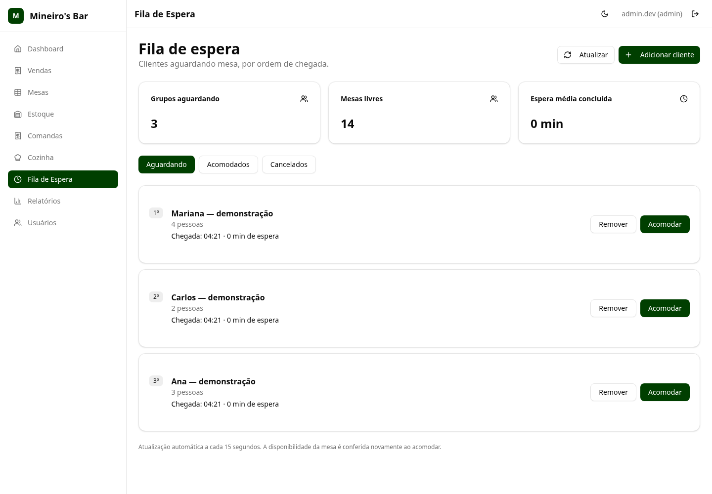

# sistemapdv
Mark1

Sistema PDV em desenvolvimento para bares e lanchonetes, com interface React, API Node.js/Express e PostgreSQL.

## Recursos da base

- Vendas, mesas e comandas.
- Entrada, saída e acerto de estoque.
- Fila de clientes integrada à ocupação de mesas e abertura de comandas.
- Usuários, relatórios e geração de comprovantes em PDF.
- Configurações do estabelecimento: nome, logo, CNPJ, contato, endereço e mensagem dos comprovantes.
- Painel separado de pedidos da cozinha, herdado do projeto original.

## Imagens do sistema

Capturas reais com dados fictícios de demonstração:

[Ver a fila de espera no celular](docs/images/fila-celular.png)

[Ver a tela de Configurações](docs/images/configuracoes.png)

## Testar no Windows com Docker

Consulte o [passo a passo da instalação local](docker/LEIA-ME.md). O Docker Compose prepara frontend, API, bancos e credenciais próprias para teste, preservando os dados em volumes.

## Desenvolvimento e validação

Consulte [DEVELOPMENT.md](DEVELOPMENT.md) para instalar, iniciar e testar no ambiente cloud. Os scripts atuais usam `/workspace/sistemapdv`.

Foram executadas 28 verificações HTTP do fluxo geral, 36 da integração fila–mesa–comanda e um teste de navegador incluindo pagamento e liberação da mesa. Os scripts de teste estão em `scripts/`.

Esta é uma base de desenvolvimento. Impressão física, assinaturas e painel master comercial completo ainda precisam ser concluídos; a separação de bancos e o suporte para consulta estão descritos na entrega multiempresa. A validação não cobre todos os fluxos herdados da aplicação. Não execute o seed antigo em um banco com dados que precisa preservar.

Credenciais, banco local e dependências são excluídos do Git.

## Auditoria funcional

As falhas da auditoria anterior foram corrigidas nos cenários executados. Consulte a [validação atual, resultados por fluxo e telas](docs/validacao-20261026/README.md). A [auditoria anterior](docs/auditoria/README.md) é mantida como histórico. Impressão física/Windows e implantação ainda precisam de validação antes de uso real.

## Bancos separados e suporte

A separação por empresa foi implementada: banco central, banco/credenciais exclusivos por cliente, login com código da empresa e ID do cliente visível apenas em sessão autorizada de suporte nas Configurações. Consulte a [arquitetura, testes e imagens desta entrega](docs/multiempresa-20261026/README.md).

## Alterações de operação do PDV local

Consulte a [lista de alterações, atualização com backup, conta Master/Admin e configuração de recuperação de senha](docs/alteracoes-pdv-local/README.md).

## Perfis e gestão comercial (0.3.0)

Perfis para bar/restaurante, pizzaria, oficina, autopeças, mercado e comércio; produtos e serviços, orçamentos, fornecedores, compras e contas a pagar/receber. Consulte a [entrega, limites por segmento e atualização guiada no Windows](docs/gestao-comercial/README.md).

## Backup e recuperação local

[Rotina criptografada, destino externo configurável, agendamento no Windows e restauração em projeto separado](docs/backup-recuperacao/README.md). O destino e o agendamento precisam ser configurados no computador da instalação.

## Pizzaria (0.4.0)

[Tamanhos, sabores, bordas, adicionais, regras de preço e preparo integrados a vendas e mesas](docs/pizzaria/README.md).

## Catálogos por perfil — Mark 0.4.1

Importação seletiva de produtos e serviços pré-cadastrados para sete perfis, incluindo Hamburgueria. Os itens entram inativos, com preços e estoque zerados, sem substituir cadastros existentes. Veja o [guia de importação e revisão](docs/catalogos-iniciais/README.md).

## Oficina mecânica — Mark 0.5.0

[Veículos, checklist de entrada, ordens de serviço, aprovação, execução, recebimento e impressão](docs/oficina/README.md). O recebimento utiliza o caixa, os pagamentos e as movimentações de estoque existentes.

## Autopeças — Mark 0.6.0

[Referências, códigos originais, aplicações por veículo, equivalências e busca no balcão](docs/autopecas/README.md), preservando preços e estoque dos produtos existentes.

## Mercado — Mark 0.7.0

[Controle opcional de lotes e validade, identificação de saldos, FEFO, conferência de devoluções e relatório](docs/mercado/README.md), integrado às movimentações de estoque.

## Balanças e etiquetas — Mark 0.8.0

[Quatro formatos EAN-13 pré-configurados, vínculo de PLUs, conferência no PDV e etiquetas A4 de gôndola](docs/balancas-etiquetas/README.md). Leitura desativada até conferir o equipamento. [Continuidade e revisão futura de permissões](docs/planejamento/continuidade.md).

- [Mark 0.9.0 — Fichas técnicas e ingredientes](docs/fichas-tecnicas/README.md)

- [Mark 0.10.0 — Pedidos de entrega](docs/entregas/README.md)

- [Roteiro de validação conjunta das Marks 0.8.0 a 0.10.0](docs/planejamento/validacao-marks-0.8-a-0.10.md)

- [Mark 0.11.0 — Combos e adicionais](docs/combos-adicionais/README.md)

- [Mark 0.12.0 — Oficina: fotos e assinaturas](docs/oficina/evidencias.md)
