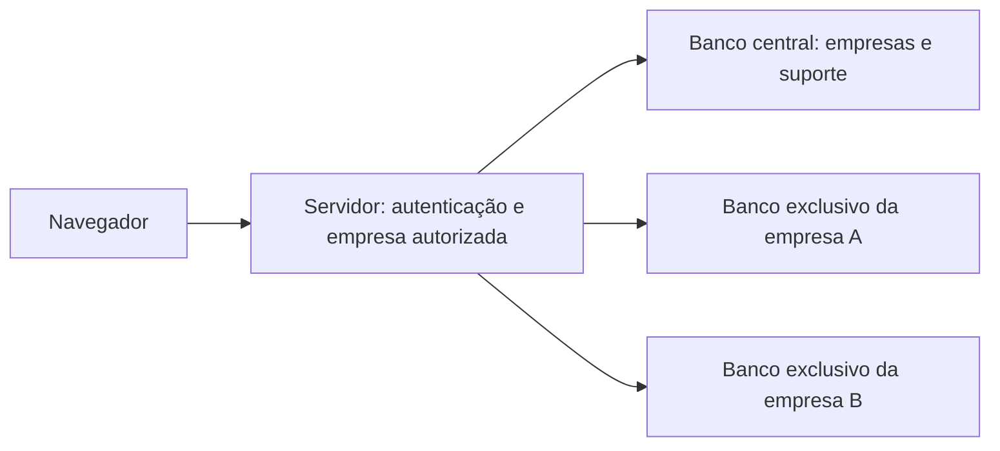

# Banco por cliente e identificação de suporte

Cada empresa passou a ter seu próprio banco PostgreSQL, com usuário e senha de banco exclusivos. O banco central contém cadastro das empresas, situação de acesso e contas/sessões de suporte. Produtos, usuários do estabelecimento, estoque, vendas, comandas e configurações permanecem no banco exclusivo da empresa.



## Login e ID do cliente

- O login do estabelecimento pede **código da empresa**, usuário e senha. O código legível, como `demo`, não é o ID técnico do cliente.
- O ID técnico é um UUID gerado no cadastro central. É estável em reprovisionamento e restauração.
- Funcionários, gerente e administrador do cliente não recebem esse UUID nas Configurações, na identidade visual pública ou no token normal.
- O campo **ID do cliente** aparece nas Configurações somente em uma sessão autorizada de suporte. A API também recusa a consulta por contas do estabelecimento.
- O suporte usa conta central própria em `/support`, escolhe uma empresa e entra numa sessão de consulta de 15 minutos, com aviso visível na tela. Alterações são recusadas pelo servidor.
- Entradas, saídas e consultas do ID ficam no registro central de suporte. Sair do suporte revoga a sessão. Trocar sua credencial pela ferramenta do fornecedor invalida acessos anteriores, preservando o ID da conta.

[Configurações vistas pelo cliente — sem ID](configuracoes-cliente.png) · [Configurações vistas pelo suporte — com ID](configuracoes-suporte.png)

As imagens mostram uma empresa de demonstração; não contêm dados de estabelecimentos reais.

## Isolamento aplicado no servidor

Não há mais conexão padrão de aplicação apontando para um banco global. A empresa é resolvida no banco central; depois de validar o JWT, o servidor seleciona a conexão pelo cadastro autorizado. Cabeçalhos, parâmetros ou dados de formulário não podem trocar o banco de uma sessão autenticada.

As classes Sequelize e associações são criadas por conexão. `AsyncLocalStorage` mantém o contexto de cada requisição; módulos de controllers, serviços e routers usam instâncias ligadas ao conjunto de modelos daquela empresa. Chamadas de modelos fora de contexto são recusadas, sem fallback para outra empresa. O cache de conexões é limitado, preserva conexões em uso e substitui pools ociosos.

Os usuários PostgreSQL de clientes não são superusuários, não criam bancos/roles e não têm CONNECT aos bancos de outros clientes nem ao central. O provisionamento e as migrações ficam em ferramenta administrativa separada; os requests normais não executam criação de bancos nem sync de modelos.

Credenciais ficam em arquivo privado no servidor (`.pdv-local/platform.json` no desenvolvimento), fora do Git e das respostas da API. O frontend não recebe nomes de banco, senhas nem a referência de conexão. O servidor Vite de desenvolvimento também nega acesso a arquivos privados e dumps SQL.

A situação da empresa é conferida em cada requisição: suspender afeta apenas a empresa selecionada, inclusive tokens já emitidos. O suporte autorizado pode consultar a empresa suspensa para atendimento. É um bloqueio técnico manual; cobrança, vencimentos, tolerância e automação financeira ainda não estão implementados.

## Preparação e administração

```bash
bash scripts/install.sh
PDV_API_PORT=4302 PDV_WEB_PORT=5189 bash scripts/start.sh
```

O bootstrap preserva o banco local anterior e o vincula à empresa `demo`, sem apagar seus dados. O administrador de desenvolvimento é `admin.dev`; a conta de suporte de desenvolvimento é `support.dev`. As senhas são geradas e mantidas no arquivo privado `.pdv-local/development.env`: nunca as publique ou copie para o código. Tokens antigos, anteriores à separação por empresa, precisam de novo login.

Ferramentas exclusivas do fornecedor:

```bash
# Defina PDV_ADMIN_USERNAME e PDV_ADMIN_PASSWORD de forma segura no ambiente.
node --env-file=.pdv-local/development.env scripts/platform-cli.cjs create-company bar-exemplo "Bar Exemplo"
node --env-file=.pdv-local/development.env scripts/platform-cli.cjs suspend bar-exemplo
node --env-file=.pdv-local/development.env scripts/platform-cli.cjs activate bar-exemplo
# Defina PDV_SUPPORT_PASSWORD de forma segura no ambiente antes deste comando.
node --env-file=.pdv-local/development.env scripts/platform-cli.cjs support-user nome-do-suporte
```

O provisionamento é serializado por lock de arquivo e rejeita nomes inválidos, banco já vinculado e uso do banco central como banco de cliente. O banco é preparado antes de publicar a empresa no cadastro central. Um erro de criação não apaga bancos/roles automaticamente; o fornecedor deve conferir eventuais recursos incompletos antes de repetir. Um lock abandonado por interrupção requer conferência administrativa, não remoção cega.

Esta etapa usa ferramentas de terminal e um acesso de suporte para consulta. Não é ainda o painel master comercial completo, nem um cadastro público de empresas. A plataforma não foi implantada em um domínio público neste trabalho.

## Backup e restauração

```bash
node --env-file=.pdv-local/development.env scripts/platform-backup.cjs
```

O snapshot privado inclui o banco central, bancos cadastrados de clientes, manifesto de integridade e configuração de conexão necessária para recuperação. Os arquivos ficam em `.pdv-local/platform-backup`, fora do Git. O snapshot anterior é preservado enquanto o novo é preparado. Ele contém dados e credenciais e deve receber armazenamento protegido, acesso restrito e uma política externa de backup antes de uso comercial.

Ao recriar o container de desenvolvimento, `scripts/database.sh` chama a restauração da plataforma. Ela recupera roles e bancos a partir do snapshot, verifica SHA-256 e mantém os IDs centrais. Bancos já existentes são preservados. Snapshot ausente, inválido ou restauração interrompida bloqueiam a preparação em vez de iniciar empresas vazias ou trocar IDs silenciosamente. A configuração privada e o snapshot devem acompanhar a cópia do ambiente; clonar apenas o Git não recupera dados de clientes.

A restauração foi testada em outra instância PostgreSQL, sem apagar o banco de trabalho: banco central e **seis bancos de empresas** foram recuperados, com mesmos IDs e metadados, contagens de usuários preservadas e acesso cruzado ainda recusado. [Resultado](restauracao.json).

O teste `scripts/platform-restore-test.cjs` requer um container novo e exclusivo chamado `pdv-restore-check`, na porta loopback 5433. Não o execute contra um servidor de dados reais. Backups de produção, agendamento e armazenamento externo ainda precisam ser preparados na implantação.

## Verificações executadas

- **63 verificações aprovadas** de isolamento/suporte: bancos e credenciais distintos; PostgreSQL recusa acesso cruzado/central; mesmo UUID de usuário em duas empresas; JWT adulterado; 24 requisições simultâneas; cabeçalhos e parâmetros não trocam contexto; leituras/escritas cruzadas; configurações independentes; ID protegido; suporte somente consulta; revogação; suspensão seletiva; ID estável. [Resultados](isolamento.json).
- **51 verificações da auditoria operacional aprovadas** dentro de uma empresa nova. [Resultados](api-resultados.json).
- Regressões operacionais: integridade **42**, fluxo geral **29**, fila **36** e configurações **27** verificações HTTP aprovadas na plataforma multiempresa.
- Navegador: 12 páginas carregadas sem erros de JavaScript/API; cadastro de usuário; operações de estoque/produtos/cozinha e exportações passaram. [Resultados](browser-resultados.json).
- Navegador de suporte: código da empresa no login, tratamento de código inexistente sem ciclo de redirecionamento, ID ausente para cliente, ID presente no suporte, campos sem edição, persistência no reload e revogação ao sair passaram.
- Cache de conexões com limite dois: terceira empresa ocupada retorna indisponibilidade controlada; pool em uso é preservado; pool ocioso pode ser substituído.
- Credencial do suporte alterada pela ferramenta do fornecedor: token anterior foi recusado.
- Compilação do frontend passou; lint sem erros, com 12 avisos de organização de exports/hooks.

Exemplos de repetição (somente dados fictícios):

```bash
PDV_API_URL=http://127.0.0.1:5189/api node scripts/tenancy-smoke.cjs
PDV_WEB_URL=http://127.0.0.1:5189 NODE_PATH=/tmp/pdv-browser/node_modules node scripts/tenancy-browser.cjs
```

Os testes operacionais existentes aceitam `PDV_COMPANY` para selecionar a empresa de teste. A auditoria de totais precisa começar com caixa fechado em empresa nova. O bootstrap de desenvolvimento não pode apagar dados para satisfazer um teste.

## Limites da entrega

O isolamento foi verificado no desenvolvimento; produção ainda exige hospedagem, HTTPS, configuração privada de banco/segredos, controle de acesso operacional e monitoramento. Não há seleção de impressoras do Windows, integração fiscal/bancária, cobrança automática, MFA do suporte ou permissões de escrita do suporte nesta etapa. O conector de impressão e o painel comercial completo permanecem para as próximas entregas. Empresas e contas dos testes devem permanecer apenas no desenvolvimento; a implantação pública deve usar provisionamento e credenciais próprios, sem publicar o snapshot de demonstração.
